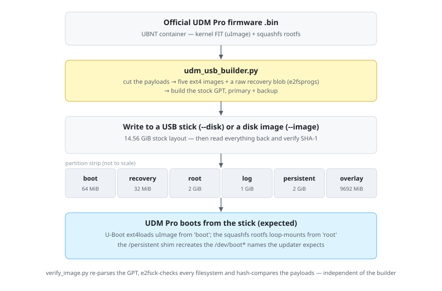

# udm-pro-usb-boot — a bootable UDM Pro USB stick, built from official firmware

<div align="center">

<a href="LICENSE"></a>
<a href="../../actions/workflows/ci.yml"></a>

**One Python script turns an official Ubiquiti UDM Pro firmware `.bin` into a USB stick
the Dream Machine Pro boots from in place of its internal storage — recreating the exact
stock GPT layout and a `/dev/boot*` shim that recreates the device names the web-UI
firmware updater hard-codes.**

</div>

> [!WARNING]
> This tool **erases a whole disk** — the wrong disk destroys all of its data permanently.
> It is a proof of concept, though a stick it built has booted a real UDM Pro. Read
> [Roadmap / known limitations](#roadmap--known-limitations) before touching hardware.

> [!IMPORTANT]
> This is a **hardware-repair** project, not a software-only mod. It targets UDM Pro units
> whose internal eMMC storage has failed: the dead **eMMC and its controller are removed from
> the board and a USB breakout is soldered in their place**, after which the UDM Pro boots from
> an ordinary USB stick. This tool only builds that stick — it is not a supported Ubiquiti
> procedure; see the Disclaimer below.

> [!NOTE]
> Not affiliated with Ubiquiti Inc. No Ubiquiti firmware or binaries are distributed here —
> the builder downloads the official `.bin` from Ubiquiti's public firmware endpoint, or
> uses a copy you already have. Built with AI assistance under human review. See
> [Legal](#legal).

## Quick start

```
# offline checks (no disk, no downloads) — works on Windows and Linux
python3 udm_usb_builder.py --selftest

# build a disk image instead of touching hardware, then check it independently
python3 udm_usb_builder.py --image test.img
python3 verify_image.py test.img
```

To write a real stick, run the guided wizard with Administrator (Windows) or root (Linux):

```
python udm_usb_builder.py
```

## At a glance

|  |  |
| --- | --- |
| **What** | Builds a bootable replacement USB stick for a UDM Pro from an official firmware `.bin` |
| **Hardware** | UniFi Dream Machine Pro (UDM Pro), AL324, kernel 4.19.x, sysid `ea15` |
| **Host platforms** | Windows (PowerShell), Linux (`lsblk`/`wipefs`) |
| **Protocol / interface** | Raw block device + GPT; UBNT firmware container; ext4 / squashfs / FIT; systemd shim |
| **Language** | Python 3 (Python 2.7 also supported) |
| **Status** | Working on real hardware — a stick built by this tool has booted a UDM Pro |
| **License** | AGPL-3.0 |

## How it compares

|  | Cloning a working unit (`dd`) | This project |
| --- | --- | --- |
| **Source** | a live UDM Pro whose storage you already have | Ubiquiti's public firmware `.bin` |
| **Produces** | a byte-copy of that one unit | a stick rebuilt from official content |
| **Needs a reference unit** | yes | no — hashes are checked against a known-good unit, but it is not required |
| **Best for** | backup / restore of an existing unit | rebuilding when there is no working unit to copy from |

## How it works

The tool reads an official UBNT firmware package, cuts the **kernel FIT** (`uImage`) and the
**squashfs rootfs** out of it, and builds the partition images of the stock layout with
`e2fsprogs` (five ext4 filesystems plus a raw recovery blob). It then writes those images at
their exact sector offsets, writes the **GPT
itself** (primary and backup, with CRCs that reproduce the real stick), and reads everything
back to verify it. Filesystem images are not padded by hand: the rootfs is padded to the next
4096-byte boundary, which is the fix for the one non-obvious failure — see
[Troubleshooting](#troubleshooting).

The disk-facing code is chosen at runtime: PowerShell `Get-Disk`/`Clear-Disk` and
`\\.\PhysicalDriveN` on Windows, and `lsblk`/`wipefs`/`blockdev` with `/dev/sdX` on Linux.
Everything above that layer — firmware parsing, the partition images, the GPT, the shim and
the read-back check — is identical on both, so the resulting stick is the same regardless of
which machine built it.



| Component | Language | Role |
| --- | --- | --- |
| `udm_usb_builder.py` | Python 3 | Parse the `.bin`, build the partition images, write the disk + GPT, verify |
| `verify_image.py` | Python 3 | Independent read-only verification of an image or a USB disk |
| `reference/flash_udm_usb.py` | Python 3 | Earlier Linux-only implementation (sgdisk/mount) — superseded, kept for reference |
| `reference/udm-boot-links.sh` + `.service` | shell / systemd | The on-device `/dev/boot*` shim, as shipped by the builder |
| `reference/project_udm_pro_boot_fix.md` | markdown | Reverse-engineering notes: squashfs padding root cause and U-Boot boot order |

## Supported hardware

| Model | SoC / variant | Status | Notes |
| --- | --- | --- | --- |
| UniFi Dream Machine Pro (UDM Pro) | AL324 (Annapurna Labs), sysid `ea15` | Verified | A stick built by this tool booted a UDM Pro; layout, payload hashes and shim derived from live 6.0.11 dumps |

## Features

- **Exact stock layout** — builds the six-partition GPT itself (primary + backup, verified
  CRCs); no `sgdisk` required.
- **Firmware in, stick out** — cuts `uImage` and the squashfs `rootfs` from any Ubiquiti `.bin`
  (URL or local file). Versions in the confirmed list are hash-verified; any other version still
  builds, with a clear "unverified" note instead of a refusal.
- **The padding fix** — pads the rootfs to a 4096-byte boundary past the squashfs
  `bytes_used`, the actual cause of the "Invalid argument" mount failure.
- **Rotation-proof shim** — installs the `/dev/boot*` systemd shim into `persistent` + the
  overlay upper layer, byte-identical (hash-locked) to a working unit, so the updater's
  hard-coded `/dev/boot*` paths exist on a non-`Generic` stick (updater behaviour not yet
  verified on hardware).
- **Cross-platform writes** — writes to a raw disk on Windows (`--disk N`) or Linux
  (`--disk /dev/sdX`), or to a disk image (`--image`) on either, then reads everything back
  and compares SHA-1 per region.
- **Independent verifier** — `verify_image.py` re-parses the GPT, runs `e2fsck` and
  hash-compares payloads without trusting the builder.
- **Disk safety** — refuses non-USB, system/boot, wrong-sector-size and wrong-size disks;
  re-reads the disk before wiping; you must type the disk's serial.
- **Guided or scripted** — an interactive wizard, or a full flag surface for automation.

## Requirements

- Python 3 (Python 2.7 also works) on Windows or Linux.
- `e2fsprogs` — `mke2fs`, `debugfs`, `e2fsck`:
  - **Linux:** usually already present (the `e2fsprogs` package); `sbin` directories are
    searched even when they are not on `PATH`.
  - **Windows:** put them on `PATH`, or let the tool install a private Cygwin copy
    (`--install-tools`).
- **Root/Admin only for `--disk`:** Administrator on Windows, `root` (`sudo`) on Linux.
  `--image` needs no elevation.
- About 6 GB of scratch space for the build.
- Network access for the firmware download (or supply a local `.bin`).

## Repository layout

```
udm_usb_builder.py     build the stick: parse firmware, build partition images + GPT, write and read back
verify_image.py        independent read-only checker for an image or a USB disk
reference/             earlier Linux implementation, the reverse-engineering write-up, and the shim source
docs/images/           README diagram
```

## Install / Usage

No installation: both scripts run in place. Build and verification are read-only and
cross-platform; only `--disk` writes real hardware.

### 1. Offline self-check

```
python3 udm_usb_builder.py --selftest
```

Checks the GPT CRCs, the embedded shim hashes and the partition alignment — no disk, no
network, any OS.

### 2. Build a disk image (safe; nothing is erased)

```
python3 udm_usb_builder.py --image test.img
```

Defaults to the known-good 6.0.11 URL. `--firmware <url|file>` overrides it (any version builds;
`--list-firmware` shows the confirmed ones); `--zero-recovery` or `--recovery FILE` change the
recovery partition; `--no-shim` omits the shim.

### 3. Verify the image independently

```
python3 verify_image.py test.img
```

### 4. Write a real stick

List the USB disks, then write one — or run with no arguments for the interactive wizard.
Use `sudo` on Linux and an Administrator prompt on Windows. **The ids below are examples —
always use the value `--list` prints for your stick**:

```
python udm_usb_builder.py --list                     # shows the USB disks; use its id below
python udm_usb_builder.py --disk <N>                 # Windows: the disk number from --list
sudo python3 udm_usb_builder.py --disk /dev/sdX      # Linux: the device node from --list
```

The stick is erased after you type its serial number (or, when a disk reports no serial, its
id). On a machine without the tool's write path, build an image with `--image` and write it
with `dd`.

## Configuration

All flags are also shown by `--help`.

| Flag | Default | Meaning |
| --- | --- | --- |
| `-i`, `--interactive` | on when no arguments and a terminal | Guided wizard: scan, pick a disk, choose firmware |
| `--list` | — | List USB disks and exit |
| `--selftest` | — | Run the offline self-checks and exit |
| `--disk ID` | — | **Erase** and build: a Windows disk number, or a Linux device node (e.g. `/dev/sdX`) |
| `--image FILE` | — | Build into a disk image instead of a real disk |
| `--firmware URL\|FILE` | UDM Pro 6.0.11 URL | Firmware source (any version; see `--list-firmware`) |
| `--list-firmware` | — | List confirmed-working firmware versions and exit |
| `--recovery FILE` / `--zero-recovery` | firmware kernel FIT | Recovery partition source |
| `--no-shim` | off | Do not install the `/dev/boot*` shim |
| `--workdir DIR` / `--tools-dir DIR` | next to the script | Scratch and e2fsprogs locations |
| `--install-tools` | off | Install e2fsprogs (private Cygwin) without asking |
| `--zero-fill` | off | Also write all-zero blocks (use on a previously used stick) |
| `--keep-work` | off | Keep the build files |
| `--allow-non-usb` / `--allow-large` | off | Lift the USB-only / 128 GiB limits (dangerous) |

## Verification

- **Offline:** `python3 udm_usb_builder.py --selftest` reproduces the real 32 GB stick's GPT
  CRCs (`1014c911` header, `1587e227` entries), matches the embedded shim hashes and checks
  the partition alignment. CI runs exactly this.
- **Image:** `--image test.img` then `python3 verify_image.py test.img` passes every check —
  primary and backup GPT CRCs, the disk GUID, all six partitions at their exact sectors,
  `e2fsck -fn` clean on the five ext4 filesystems, the shim script and unit equal to a working
  unit, the recovery partition equal to the firmware's kernel FIT, and — when the image is a
  confirmed version — the payloads equal to the hashes below.
- **Platforms:** the Linux build + verify (real 6.0.11 firmware, every check passing) was run
  here; the Windows path was not re-run in this workspace.
- **On hardware:** a USB stick built by this tool booted a real UDM Pro. That build used an
  earlier revision; the current revision has not been re-run to boot since the Windows/Linux
  refactor.

`--list-firmware` prints the confirmed-working list. Confirmed so far:

| Firmware version | `uImage` sha256 | `rootfs` sha256 |
| --- | --- | --- |
| `UDMPRO.al324.v6.0.11.dd9ab55.260930.0750` | `244326e87858b88fd0267cbb2b9c64577011723fab8240f05efe5bcc8318036b` | `f570133c01955ce7c008b18d66cb15047956dfab90e0d03992ffb17c4deccb6f` |

## Roadmap / known limitations

- **Known:** booting a UDM Pro from a stick this tool built is confirmed on hardware (earlier
  revision); the current revision's raw-disk `--disk` path has not been re-run on hardware
  since the Windows/Linux refactor.
- **Known:** the recovery partition is written from the *firmware's own kernel FIT*, inferred
  from strings in the updater ("Failed to update recovery kernel", "Failed to copy kernel
  partition to recovery partition"). The `.bin` contains no recovery section — override with
  `--recovery FILE`, or leave it empty with `--zero-recovery`.
- **Known:** the layout and shim are proven only for 6.0.11 / sysid `ea15`. Other versions
  build without any override, but are not hash-verified (no confirmed entry) — the structural
  checks (FIT / squashfs magic, `bytes_used`, 4096-alignment) still run.
- **Known:** a disk that reports neither a serial nor a WWN has no unique identity, so a
  same-model swap between `--list` and the write cannot be detected; the confirmation then
  falls back to typing the device path.
- **Planned:** a `blkdiscard` before partitioning on Linux, and a re-run of the Windows write
  path into the test matrix.

## Troubleshooting

<details>
<summary><b>Troubleshooting / FAQ</b></summary>

**`rootfs` fails to loop-mount with `Invalid argument`, and `dmesg` shows no `SQUASHFS error`**
— the squashfs was cut at its superblock `bytes_used` instead of padded to the next
4096-byte boundary. Ubiquiti's own files are padded; the builder pads automatically. If you
extracted a rootfs by hand, pad it yourself. See `reference/project_udm_pro_boot_fix.md`.

**The web-UI updater says `Failed to mount /dev/boot1`** — the `/dev/boot*` shim is missing
(built with `--no-shim`) or the stick's SCSI vendor does not start with `Generic`. Rebuild
without `--no-shim`.

**`e2fsprogs` (`mke2fs`/`debugfs`/`e2fsck`) not found** — Linux: `sudo apt-get install
e2fsprogs` (or `dnf`); Windows: `--install-tools` installs a private Cygwin copy.

**"run as root" / Administrator, or `cannot open /dev/sdX`** — raw disks need elevation:
`sudo` on Linux, an Administrator prompt on Windows. Also close anything using the stick.

**`--list` shows nothing or the wrong bus** — the tool only shows USB by default. `--list
--allow-non-usb` shows every disk with the reason each is refused.

</details>

## Credits

No third-party code is vendored; `e2fsprogs` is invoked at runtime, not bundled.

<details>
<summary><b>Legal</b></summary>

- **Not affiliated with, or endorsed by, Ubiquiti Inc.** "UniFi" and "Dream Machine" are
  trademarks of Ubiquiti Inc.
- **No Ubiquiti firmware or binaries are distributed here.** The builder downloads the
  official `.bin` from Ubiquiti's public firmware endpoint (`fw-download.ubnt.com`) or uses a
  local file you supply.
- Interoperability work was performed against hardware the author owns.

</details>

<details>
<summary><b>Disclaimer</b></summary>

**Intended use — repair of a physically modified board.** This project exists to get a UniFi
Dream Machine Pro whose **internal eMMC storage has failed** working again. That repair is
physical: the dead **eMMC and its controller are removed from the board and a USB breakout is
soldered in their place**, after which the UDM Pro boots from an ordinary USB stick. This tool
only builds that stick. It is **not** a supported Ubiquiti procedure, the modification
**voids the warranty**, and **a botched rework can destroy the unit** — do it only on hardware
you own and are willing to lose.

**This is a proof-of-concept project, not a production-ready system.** Large parts were
produced with LLMs under human supervision and testing — review and verify everything
yourself. **This software is provided "as is", without warranty of any kind.** It performs
invasive operations (erasing a whole disk, rewriting a device's boot storage), so you can
**lose data, render a UDM Pro unbootable, and void warranties**; recovery may require
physical or serial access and is never guaranteed. By using it you accept full
responsibility. **The authors and contributors are not liable for any loss or damage arising
from its use.**

</details>

## Security

Report vulnerabilities privately via GitHub Security Advisories. The tool handles no
credentials or tokens; the only network traffic is the firmware download from Ubiquiti's
public endpoint.

## License

AGPL-3.0. See [LICENSE](LICENSE).
